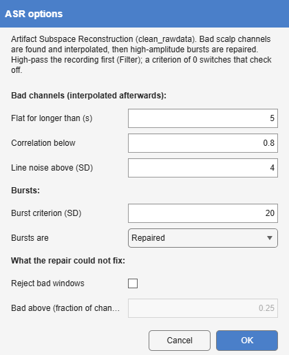

*Tools > 2. Artifact Rejection / Reduction > ASR · continuous → continuous ·
`ASR`*

Artifact Subspace Reconstruction, from EEGLAB's clean_rawdata plugin
[@mullen2015]. It first finds scalp channels that are flat for too long or
that their neighbours predict poorly, and interpolates them. Then it learns,
from the cleanest stretches of the recording, what the scalp's covariance
normally looks like; wherever a sliding window's variance exceeds that by
more than the **burst criterion** along some direction, the offending
components are reconstructed from the clean ones. Large, brief artefacts
(movement, electrode pops, muscle bursts) are repaired, and the rest of the
recording is untouched.

{#fig-asr-dialog}

| Option | Default | Meaning |
|------------------------------------|---------|-------------------------------------------------------|
| **Flat for longer than** | 5 s | A channel flat for longer than this is bad; 0 switches the check off. |
| **Correlation below** | 0.8 | A channel correlating less than this with its prediction from its neighbours, for more than half the recording, is bad; 0 switches it off. |
| **Line noise above** | 4 SD | A channel with this much more line noise than the rest is bad; 0 switches it off. |
| **Burst criterion** | 20 SD | How far a window may exceed the calibration before it is repaired. Lower is more aggressive. |
| **Bursts are** | Repaired | **Repaired**, or **Rejected**: every sample ASR would change is marked rejected instead. |
| **Reject bad windows**, **Bad above** | off, 0.25 | After the repair, reject windows in which more than this fraction of the channels are still out of range. |

: ASR's options. The criterion defaults to 20, the value clean_rawdata's own dialog proposes, within the 20 to 30 found to work on real EEG [@chang2020]. {#tbl-asr}

ASR assumes data without slow drifts, so **high-pass the recording first**
(Filter, about 0.5 to 1 Hz). clean_rawdata applies its own high-pass inside
the same function; here it is left to Filter, so that each operation is a
step of its own in the tree, and ASR warns when the recording still carries
large offsets. The flagged channels are interpolated back in their own
places, so the montage is unchanged. A **rejected** stretch is marked
rejected (`NaN`) on every channel rather than cut out, so the recording keeps
its length and its events their latencies; an epoch cut across it keeps
`NaN` there, which Average leaves out sample by sample. Only scalp channels
with a position calibrate ASR and are cleaned; the others are left as they
were.

clean_rawdata ships with EEGLAB and is installed through EEGLAB's plugin
manager when it is missing. The data-quality report lists, per subject, the
channels interpolated, the share of samples repaired and rejected, and the
criterion used.
